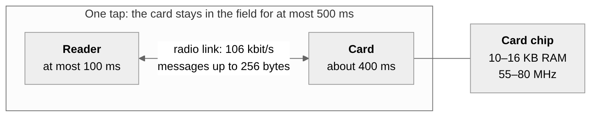
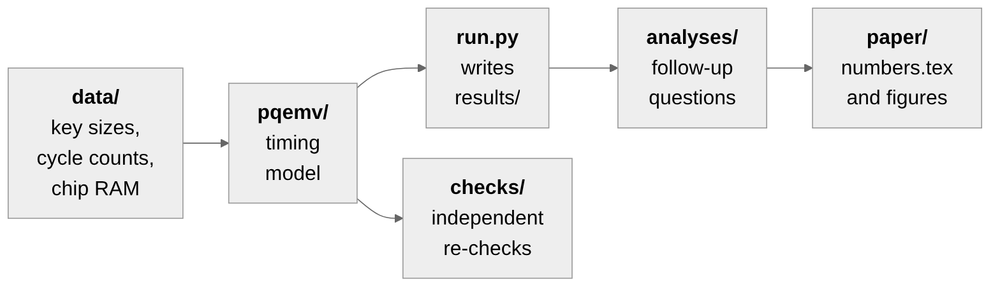

# pq-emv-tap

Code for our ICTCS 2026 paper **"Does Post-Quantum Card Authentication Fit a Contactless Tap? A Test Against EMV's Own Rules"**.

When you tap a bank card, the card proves it is genuine using RSA or elliptic-curve signatures. A large quantum computer could break both. So we asked a simple question: if the card switched to post-quantum algorithms (ML-DSA, FN-DSA or ML-KEM), would the tap still finish within the time and memory limits that EMV sets?

We did not build a card. Instead we wrote a timing model that follows the EMV specifications frame by frame and uses published cycle counts and chip data sheets. This repo has that model and every number in the paper.

## The limits we test against



## What we found

| Design | Result |
|---|---|
| Card decapsulates a KEM ciphertext (Kernel 8 style) | The reader runs out of its 100 ms. Even the best design misses by about 10 ms. |
| Card signs (Kernels 2 and 3) with ML-DSA or FN-DSA-1024 | Just sending the certificates and the signature takes 680–1730 ms, far over the card's 400 ms. |
| ML-DSA signing on the card | No published signer that runs on these chips fits in their RAM. |
| FN-DSA-512 signing on the card | It fits the transfer time, but the chip would need to run at about 285 MHz. |

## Running it

You need Python 3.10 or newer. Nothing else to install.

```
git clone https://github.com/Alternateacc-1/pq-emv-tap.git
cd pq-emv-tap
python run.py
```

It takes a few seconds. You should see:

```
benchmark tables: skipped (sources/ not cloned)
tests: 31 passed; transport rows 98; computation rows 564; RAM rows 79
hand checks: 33 passed (T13)
numbers pipeline: 543 macros, regenerated identically
figures: 3 CSVs regenerate identically; 19 printed values are macros; each PDF carries its CSV hash
```

`run.py` recomputes everything and stops with an error if any result differs from the one in this repo. We ran it on Windows and Linux, with Python 3.10, 3.12 and 3.13, and got the same output every time.

## How the code fits together



```
pqemv/               the model
  transport.py         timing of radio frames, delays and waiting-time extensions
  architectures.py     the messages each design sends
  implementations.py   which algorithm code runs on which chip, and its cost
analyses/            follow-up questions (one script each, results go to results/)
paper/               make_numbers.py and make_figures.py, and their output
data/                the input numbers, each with its source and page
docs/                modelling_choices.md and hand_calculations.md
tests/               a hand-calculated check that run.py repeats
checks/              a second, independent implementation and some what-if checks
```

Every time is computed twice, once with a formula and once by stepping through the frames one by one. `run.py` stops if the two ever disagree.

## Where does a number in the paper come from?

Every number in the paper is a LaTeX macro in `paper/numbers.tex`. Look the macro up in `paper/numbers_manifest.csv` to see its exact value, the script that computes it and the result file it comes from.

For example, `\FnineMarginTpMs` is −10.184 ms, the amount by which the best Kernel 8-style design misses the reader's 100 ms. It comes from `results/kernel8_rmin.json`, written by `analyses/kernel8_rmin.py`.

## Extra checks

The scripts in `checks/` are not needed for the paper's results; they test them.

- `independent_model.py` rewrites the timing model from scratch and gets the same 25 headline numbers.
- `reader_after_removal.py`, `extended_apdus.py`, `record_packing.py` and `type_b.py` ask "what if" questions: what if the reader checks certificates after the card leaves, uses longer messages, packs records tighter, or talks to a Type B card. None of them changes the conclusion within EMV's rules.

Run any of them with `python checks/<name>.py`. The output we got is in `checks/out/`.

## Data and specifications

The cycle counts come from the [pqm4](https://github.com/mupq/pqm4) (commit `5e5cc76`) and [pqm3](https://github.com/mupq/pqm3) (commit `48757b8`) benchmark tables. To re-read them yourself, clone both into `sources/`. `run.py` will then check our copies against them:

```
git clone --recurse-submodules https://github.com/mupq/pqm4 sources/pqm4
git -C sources/pqm4 checkout 5e5cc76
git clone --recurse-submodules https://github.com/mupq/pqm3 sources/pqm3
git -C sources/pqm3 checkout 48757b8
```

The EMV specifications are free from [EMVCo](https://www.emvco.com) but may not be redistributed, so they are not here. The code cites the clause for each rule it uses.

To redraw the figures you need matplotlib: `pip install -r requirements-figures.txt`, then `python paper/make_figures.py`.

## Citing

The code is under the MIT licence. If you use it, please cite the paper:

> T. Mogare, S. Pakhale, S. Shinde, M. Vasaikar and R. Deshmukh, "Does Post-Quantum Card Authentication Fit a Contactless Tap? A Test Against EMV's Own Rules", ICTCS 2026, Lecture Notes in Networks and Systems, Springer.
